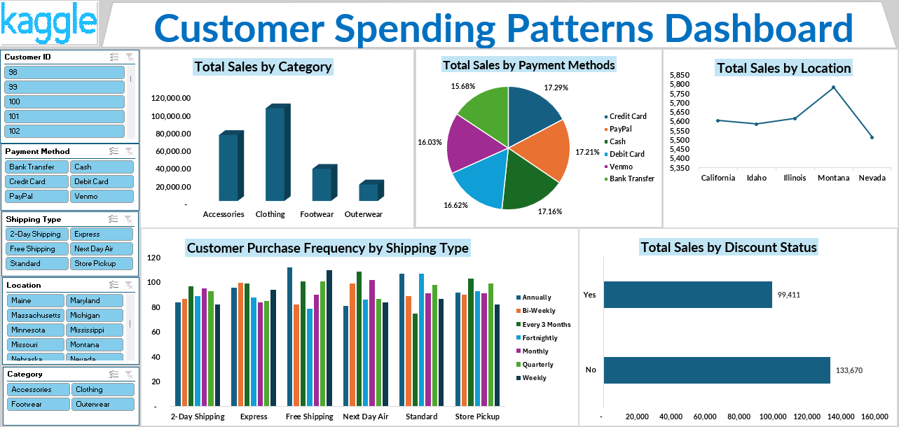

 # DATA ANALYTICS PORTFOLIO

# Project 1

**Title:**[Customer Spending Patterns Dashboard](https://github.com/SylvesterAmhandin/SylvesterAmhandin.github.io/blob/main/CUSTOMER%20SPENDING%20PATTERNS%20DASHBOARD.xlsx)

**Tools Used:** Microsoft Excel (Pivot Table, Pivot Chart, Power Query, Conditional Formatting, Slicers)

**Project Description:** 

**Key findings:**

**Dashboard Overview:** 

# Project 2

**Title:** SQL Data Definition Language - Sales Data

**SQL Code:** [Sales Data](https://github.com/SylvesterAmhandin/SylvesterAmhandin.github.io/blob/main/Sales_Data.SQL)

**SQL Skills Used:**

**Project Description:**

**Technology used:** SQL server
